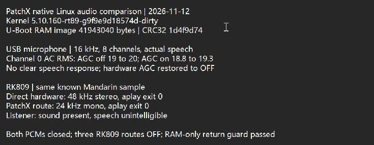

# PatchX 原生 Linux 音频对照

2026-11-12 在同一块 RK3568 上使用 U-Boot 一次性启动原生 Linux。镜像 41943040 字节，CRC32 `1d4f9d74`。实测内核 `5.10.160-rt89-g9f9e9d18574d-dirty`，taint 为 0。加载了该内核匹配的 RK817 codec 模块，识别到 Bothlent USB 麦克风和 RK809 声卡。Android 的缓存分区在 Linux 中只读挂载。

| 验证 | 原生 Linux 结果 |
| --- | --- |
| USB 原始八通道 | 16 kHz、S16_LE，采集 14 秒，覆盖安静和用户讲话。八通道都没有明显的讲话电平变化，通道 0 的去直流 RMS 为 19.0–20.0。 |
| USB 自动增益 | 读回自动增益为 ON 后再采 14 秒，通道 0 的去直流 RMS 为 18.8–19.3，未见改善。测完读回已恢复 OFF。 |
| RK809 直连 | 同一段已知普通话，直连硬件 48 kHz、S16_LE 双声道，aplay 退出码 0。现场有声音，人声听不清。 |
| 应用 ALSA 播放路径 | 同一段音频通过 `patchx_playback`，24 kHz 单声道输入，aplay 退出码 0。现场仍有声音，人声听不清。 |

对照 [Android 内核上的实测](../patchx-physical-voice-20261112/README.md)，两边都复现了同样的麦克风和扬声器症状。原始 USB 采集绕过了应用的通道映射，直连 RK809 绕过了应用的采样率和通道转换。这些结果把问题缩小到两套系统共用的音频路径。仍需通过替换已知正常的 USB 麦克风和独立检查 RK809 输出、功放及扬声器，才能区分设备、板级配置和驱动底层参数。

本轮只记录麦克风电平，未保存或上传用户录音。本地输入输出先决条件未通过，未重复在线 ASR/LLM/TTS。正式代码无改动。测试结束时三路 RK809 控件均为 OFF，两端 PCM 已关闭。卸载 codec 并解绑音频接口后，PID1 通过独立 RAM 回退检查。远程 ADB 已重新确认 Android 11 正常启动，新增的临时缓存文件已移除。

[板端事件和电平数据](board-events.json)

