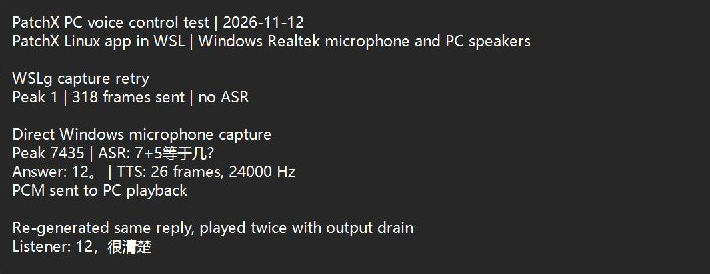

# PatchX PC 语音对照

2026-11-12，在同一台 Windows PC 的 WSL 中运行当前 Linux PatchX，沿用已有在线语音服务。PC 音频测试通过临时桥接使用 Windows 麦克风和默认扬声器，产品源码无改动。

| 输入和输出 | 实测结果 |
| --- | --- |
| 合成普通话输入 | ASR 识别“1+1等于几？”，回答“2。”，解码 21 帧、24 kHz PCM。走 PC 扬声器播放时，现场听到像是“2”。 |
| WSLg 麦克风 | 第一次用户没赶上录音窗口，不计为真人语音验收。第二次采集上传 318 帧，PCM16 峰值只有 1，未返回识别。 |
| Windows Realtek 直采 | DirectShow 从实际麦克风取 16 kHz 单声道 PCM，在内存交给同一套 PatchX 状态机和 Opus 编码。峰值 7435，ASR 识别“7+5等于几？”，回答“12。”，26 帧 TTS 写入 PC 播放端。 |
| PC 听感确认 | 应用户要求用同一道题重新生成回答，播放两遍并等输出排空。用户确认“12，很清楚”。 |

首次 Windows 直采返回 255616 字节，约 7.988 秒。临时测试脚本误将时长要求写成恰好 8 秒而拦截了该次上传。放宽至合理的采样长度范围后重采成功。录音只经内存传输，没有留存音频文件，临时配置和凭据文件已清理。

同一套代码和语音服务能处理实际 PC 麦克风的讲话并输出清楚人声。结合 RK3568 在 Android 与原生 Linux 下的两组本地对照，板端故障仍集中在它的采集和播放路径，具体硬件或底层配置待确认。

[测试日志](pc-voice-events.json)

