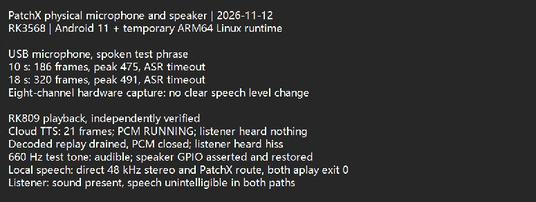

# PatchX 物理麦克风和扬声器测试

2026-11-12 通过远程 ADB 在 RK3568 3568A 上测试。板子启动 Android 11，PatchX 运行在临时 ARM64 Linux 用户空间。Android RK809 只提供 `Playback Path` 和 `Capture MIC Path`，正式 Linux 路由检测还要求 `Resume Path`，因此正式路由入口拒绝了初次测试。后续用临时适配核对实际提供的两项枚举，测试后读取两项均为 OFF。正式 Linux 源码无改动。

| 验证项 | 板端和现场结果 |
| --- | --- |
| USB 麦克风 10 秒、18 秒 | 两轮均进入采集状态，分别上传 186 和 320 帧。PCM16 峰值为 475 和 491。两轮都没有识别文本或回复。用户确认第一轮已在窗口内讲话。 |
| USB 原始八通道 | 14 秒、16 kHz、S16_LE。捕获开关为开，AGC 为关。各通道逐秒电平没有明显的讲话变化，通道 0 的去直流 RMS 为 20.1–20.6。仅记录电平，原始音频未落盘、未上传。 |
| 合成输入加云端 TTS | 正常返回“1+1等于几？”和“2。”，收到 21 帧 Opus，应用已向 aplay 写 PCM，硬件进入 RUNNING。现场未听到回答。 |
| 同类云端回答解码后完整播放 | 24 kHz，原始回复 60480 字节，重复播放并等待 aplay 退出、PCM 关闭。现场听到呲呲声，听不清人声。 |
| 660 Hz 测试音 | 用户听到了测试音。GPIO148 的功放控制随播放从高变低，RUNNING/DRAINING 期间保持低，关闭后恢复高。 |
| 本地已知普通话 | 先直连 RK809 硬件播放 48 kHz 双声道，再经 `patchx_playback` 播放 24 kHz 单声道。两次 aplay 均以 0 退出。用户确认两次都有声音，均听不清人话。 |

真实语音整链路未通过。原始八通道采集同样缺少可辨认的讲话电平变化。扬声器问题在绕过云端、Opus 和应用播放路径后仍可复现。测试覆盖的是现场 Android 音频驱动和物理设备组合，尚未确定麦克风前端、声卡时钟或模拟输出中的具体故障。结束时 USB 采集和 RK809 播放 PCM 均已关闭，功放 GPIO 回到测试前状态，临时环境和语音凭据已清理。

[板端日志](board-events.json)

