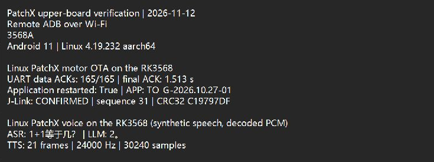

# PatchX 上层 OTA 和语音验收

2026-11-12 通过 Wi-Fi 远程 ADB 核对 RK3568 3568A。上层板当前启动的是 Android 11，Linux 内核为 4.19.232，架构为 aarch64。OTA 和语音都由板上临时启动的 ARM64 Linux 用户空间执行。语音使用私有挂载命名空间和独立根目录，共用板上的 Wi-Fi。

## 电机板 OTA

在 Linux PatchX 源码目录，先退出占用电机串口的服务，再执行：

```sh
python3 -m apps.patchx.motor_ota --port /dev/ttyS0 /path/to/PatchX_edu.bin
```

本次在 Android 的板级节点上使用 `/dev/ttySMT0`。维护入口使用现有串口独占机制，校验 APP 地址和向量，确认停止指令后才发 OTA。每包等待独立回执。遇到传输超时停止发送，末包超时仍可查询重启状态。末包回执、重启应答和镜像确认分别记录。

电机动力断开。升级前 J-Link 确认正在运行的是已修复末包回执的 APP。本次上传同一 42080 字节镜像，CRC32 为 `C19797DF`。上层实板程序收到 165/165 包回执，末包 1.513 秒，之后查询确认序号归零和版本恢复应答，未观察到活动 OTA 故障。J-Link 核对片内 APP 和外部 Flash A/B 槽字节一致，Bootloader 区与升级前一致。元数据序号从 `30/TRIAL` 转到 `31/CONFIRMED`，最终 `trials=0`、`error=0`。电机板已恢复应用运行。

上层 PatchX 回归共 148 项通过，包含 OTA 完整应答、末包回执丢失、中间包超时和无效镜像。

[程序输出](ota.json) · [J-Link 回读](flash-readback.json)

## Linux 语音

在同一块板上运行现有 PatchX 产品状态机，通过已有语音后端进行一次 realtime 对话。输入是合成普通话“ 一加一等于几 ”的 16 kHz 单声道 PCM，走实际 Opus 编码和 WebSocket。ASR 返回“1+1等于几？”，回答为“2。”。收到 21 帧 Opus，实际解码为 24 kHz、30240 个 PCM 样本，峰值 27285，播放状态正常结束并回到 idle。物理麦克风和扬声器的录放音另行验收。

临时运行包缺少可用的库发现环境，初次连接在创建 Opus 编解码器时失败。通过私有 Linux 根目录和设备挂载恢复库发现后，复测使用现有产品代码通过。运行包和临时凭据文件已从板端移除，Wi-Fi 保持连接。

[远程 ADB 系统信息](adb-system.txt) · [语音输出](voice.json)


